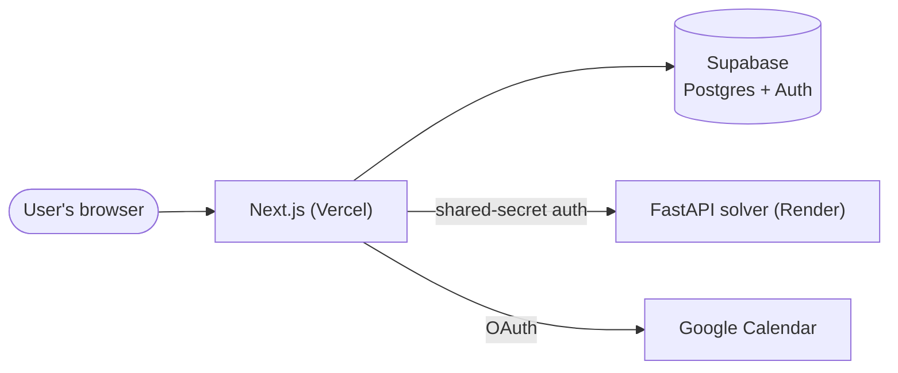

# Nextly

[](https://github.com/milaZelt/adaptive-scheduler/actions/workflows/ci.yml)

**[Live demo →](https://adaptive-scheduler-chi.vercel.app)**. Click "Try Demo," no account needed.

Nextly is an adaptive weekly scheduler. You give it tasks, each with a priority and a deadline, and it decides *when* to do them, fitting them into the open space around the fixed events already on your calendar. It's not a to-do list sorted by due date: placement is solved by a constraint solver, not a greedy heuristic.

## What makes this worth a look

- **Real optimization, not a sort.** The backend runs Google OR-Tools' CP-SAT solver with a genuine lexicographic multi-tier objective: maximize completed High-priority tasks first, break ties by deadline urgency, then by task length. That result gets locked in, then the same process repeats for Medium, then Low. A lower tier can never influence a higher tier's outcome, even indirectly.
- **Explains its own decisions.** Every placed session can say why it landed there, in plain terms like "your only High-priority task this week" or "your 12-1:30 class was in the way," built from data the solver already produced, not a separate guess bolted on after.
- **Google Calendar integration done carefully.** Real OAuth refresh-token lifecycle, timezone-safe event conversion that never trusts the server's local clock, multi-day all-day events expanded correctly across the planning window.
- **A demo that's actually live**, not a screen recording. Click through with zero sign-up: anonymous auth seeds real example data, runs the real solver, and the account cleans itself up automatically after 24 hours.
- **Tested and operated, not just working on my machine.** 91 frontend unit tests, 32 backend tests, and a Playwright E2E suite covering real sign-in through a real solve, all run in GitHub Actions on every push across three jobs (frontend, backend, end-to-end). Deployed for real on Vercel and Render, including the unglamorous parts: catching a Vercel function-timeout that would've broken the first request after any idle period, and warming the backend early so a cold start rarely reaches the user at all.

## Stack

| | |
|---|---|
| Frontend | Next.js 16 (App Router), React 19, TypeScript |
| Backend | FastAPI, Google OR-Tools (CP-SAT) |
| Data & auth | Supabase (Postgres, Row-Level Security, OAuth) |
| Testing | Vitest, pytest, Playwright |
| CI/CD | GitHub Actions |
| Hosting | Vercel (frontend), Render (solver) |

## How it fits together



The solver is stateless: it holds no database credentials and is only ever reachable from Next.js's own server, never the browser. Next.js gathers the scheduling request, calls the solver over a shared-secret-authenticated endpoint, validates the response as untrusted input, then persists it. Every user-owned table is scoped by Row-Level Security, so one user's data isn't reachable through another's queries even if application logic had a bug.

## Running it locally

```bash
# Backend
cd backend
python3 -m venv .venv && source .venv/bin/activate
pip install -r requirements.txt
cp .env.example .env          # fill in SOLVER_SHARED_SECRET
uvicorn api.main:app --reload --port 8000
```

```bash
# Frontend, separate terminal
cd frontend
npm install
cp .env.example .env.local    # fill in Supabase and Google OAuth values
npm run dev
```

You'll need your own Supabase project and Google OAuth client. See `frontend/.env.example` and `backend/.env.example` for the full list of what to fill in, and `frontend/README.md` / `backend/README.md` for more detail on each side.

### Running the tests

```bash
cd backend && python -m pytest tests/ -v
cd frontend && npm run test:unit && npm run test:e2e
```

## License

All rights reserved. This code is public for portfolio review, not for reuse. See [LICENSE](LICENSE).
